<p align="center">
  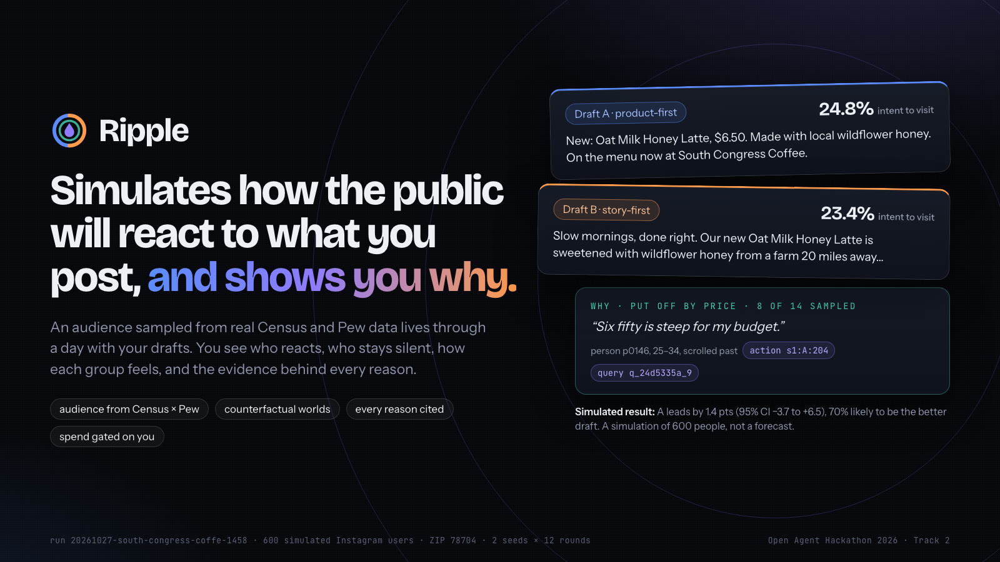
</p>

<h1 align="center">Ripple</h1>

<p align="center">
  <b>Ripple simulates how the public will react to what you post, and shows you why.</b><br>
  An agent that simulates public reaction to anything you post (ads, tweets, LinkedIn comments, announcements) on an audience built from real Census and Pew data, then explains who reacts, who doesn't, and why, with evidence for every reason.
</p>

<p align="center">
  
  
  
  
  <br>
  
  
  
  
</p>

<p align="center">
  <a href="#-quick-start-for-judges">Quick start</a> ·
  <a href="#-how-ripple-explains-why">How it explains why</a> ·
  <a href="#-see-it">Screenshots</a> ·
  <a href="#-how-it-works">How it works</a> ·
  <a href="#-results-so-far">Results</a> ·
  <a href="#-sponsor-technology">Sponsor tech</a> ·
  <a href="#-traces">Traces</a> ·
  <a href="#-limitations">Limitations</a>
</p>

---

Anything public is posted blind. An ad, a tweet, a LinkedIn comment, a launch announcement or a statement goes out, and you don't know how different people will react until they do. When something lands badly, or lands in silence, you never learn why: the people who scrolled past don't tell you, and the reasons behind a reaction aren't in any dashboard.

Ripple runs that reaction first, as an agent loop: **Build the audience → Simulate → Investigate → Explain → Recommend (gated).** It builds a synthetic audience from real data for the platform and place you are posting to (Instagram, Facebook, TikTok, YouTube, X or Reddit; any US ZIP from the Census, or any country from the World Bank), with a receipt for every trait. It simulates a day of that audience seeing your drafts (a post, an image, an ad or a short campaign) in counterfactual worlds that are identical except for the content, with memory, competing posts and shares that spread through a follower graph. It investigates the run's own event log with SQL, explains each reason with the query or action it came from, and recommends what to do next, holding anything that spends or publishes for the owner. You get who reacts, who stays silent, how each group feels, and why, with evidence.

Give it two drafts and it also says which one leads in the simulation and why; the counterfactual worlds are what keep that comparison fair. The result reads like: "A leads on intent to visit: 24.8% vs 23.4% (+1.4 pts, 95% CI −3.7 to +6.5); A ahead in 2 of 2 seeds; 70% likely to be the better version." A draft only "wins" when the 95% interval excludes zero and every seed agrees; no measurable difference is itself a result.

<p align="center">
  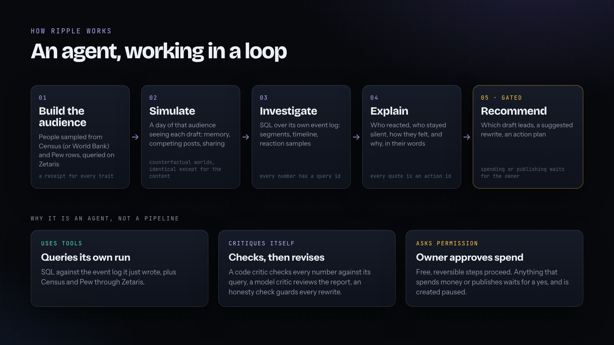
</p>

Three things make it an agent rather than a pipeline:

- **It uses tools.** The report agent queries its own run log with SQL (segment breakdowns, timeline, reaction samples, audience vs Census) alongside the federated Census and Pew data, and must cite the query id behind every number.
- **It critiques and revises itself.** A code critic checks every number against its query and rejects invented prices, a model critic (Nemotron Ultra) reviews the explanation and can send it back once, and an honesty check rejects any rewrite that invents claims or hides the price or offer.
- **It has a permission model.** Free, reversible actions go ahead on their own, such as drafting a rewrite from the objections. Anything that spends money or publishes waits for the owner's approval, and is created paused.

## 🔎 How Ripple explains why

<p align="center">
  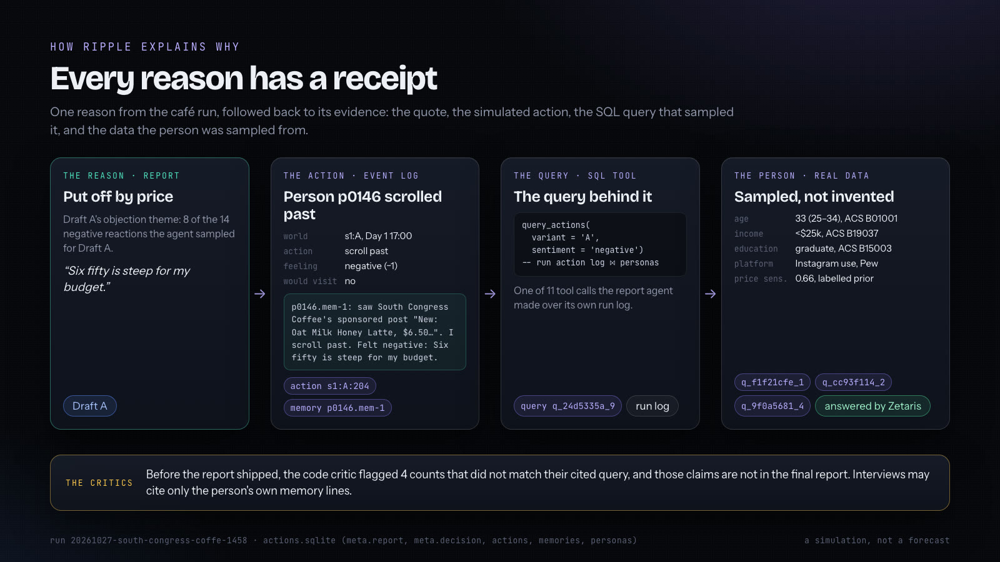
</p>

Every reason in a Ripple result points back to evidence you can open. The investigation draws on four kinds of source:

| Source | What it answers | How it is cited |
|---|---|---|
| **US Census ACS (or World Bank) and Pew Research**, federated through Zetaris | Who is in the audience, and how many people on the platform the poster can reach | Every persona field carries the query id and table cell it came from |
| **The run's own event log**, queried with SQL | Who reacted, how and when; who stayed silent; what people kept to themselves; how intent shifted around a competing post | Every claim in the report lists its query ids; every quote is an action id |
| **Each person's H-MEM memory** | Why one person did what they did | Interview and focus-group answers cite the memory lines they use; asked about something they never saw, a person says so |
| **The critics** | Whether the explanation is supported by the data | Code critic, model critic and honesty-check results are written to the trace |

The report agent works like an analyst with a database: it calls tools that run SQL over the run's action log joined to the personas ([src/report/tools.ts](src/report/tools.ts)), writes claims, and then has to get them past a code critic. A percentage must match a fraction in the rows it cites, a count must match an integer cell, a price must appear in the post, and a claim with no query id is rejected ([src/report/agent.ts](src/report/agent.ts)). A model critic then reads the report for overclaiming and can send it back once with `request_revision`. The result is a set of reasons grouped by theme, each with its quotes, each quote one click from the simulated action and the person behind it.

The image above is one real trail from the headline run (`20261027-south-congress-coffe-1458`). Draft A's objection theme, "put off by price", covers 8 of the 14 negative reactions the agent sampled for A with query `q_24d5335a_9`. One of them is action `s1:A:204`: person `p0146` scrolled past and gave the private reason "Six fifty is steep for my budget." That person's age, income and education come from ACS queries and their Instagram use from a Pew query, all answered by Zetaris. In the same run the code critic flagged 4 counts that did not match their cited query, and those claims are not in the final report.

### It knows what it doesn't know

> [!IMPORTANT]
> Ripple reports **simulated** reactions. It does not forecast real-world sentiment or real winners. We tested whether it could: on 50 real Upworthy headline A/B tests, a 4B local model running the simulated audience scored 22.5 of 50, which cannot be told apart from a coin flip (see [Results](#-results-so-far)). The design accounts for that. Ripple reports every simulated reaction with its measured uncertainty (a 95% interval, agreement across seeds and how likely one draft is to be better) and the evidence behind it, and its recommendation is gated on the owner, not on the simulation picking a winner.

Built for the Open Agent Hackathon 2026, Track 2 (The Agent That Can Explain Why) and the NVIDIA Nemotron award. Sponsor tech: NVIDIA Nemotron, Meterless (Nightshift and the H-MEM, World Model and Markovian engines), Zetaris. Details: [docs/SPONSOR_TECH.md](docs/SPONSOR_TECH.md).

### At a glance: the 600-person café run (1458)

<table>
  <tr>
    <td align="center"><h3>600</h3>simulated Instagram users in ZIP 78704</td>
    <td align="center"><h3>2 × 2</h3>seeds × counterfactual worlds, hash-verified</td>
    <td align="center"><h3>3,328</h3>simulated decisions</td>
    <td align="center"><h3>+1.4 pts</h3>Draft A leads, 70% likely better</td>
    <td align="center"><h3>14,637</h3>people per draft a live split test needs</td>
    <td align="center"><h3>$0</h3>ad spend; launch waits at the spend gate</td>
  </tr>
</table>

## 🚀 Quick start for judges

Three paths. Pick the one that matches what you have.

**1. Docker, sample mode, no credentials.**

```bash
docker build -t oah-submission .
```

```bash
docker run --rm -p 8000:8000 -e SAMPLE_MODE=true oah-submission
```

Verified on 27 Oct from a fresh clone: the image builds, and with no `.env`, no Zetaris and no Nightshift all three `input_examples` return a full result (result, report, spend gate) in about a second each. In that mode the simulated audience is the offline persona model and the trace says so (`served_by: offline-model`).

**2. Docker with Nightshift and Zetaris on the host.** Start Nightshift and the Zetaris bundle on your machine first ([docs/SPONSOR_SETUP.md](docs/SPONSOR_SETUP.md)), fill `.env`, point the base URLs at `host.docker.internal`, then:

```bash
docker run --rm -p 8000:8000 --env-file .env oah-submission
```

Set `NIGHTSHIFT_BASE_URL=http://host.docker.internal:8088/v1`, `ZETARIS_BASE_URL=http://host.docker.internal:8888` and `OLLAMA_BASE_URL=http://host.docker.internal:11434` in `.env`, and mount the Zetaris table registry so the container knows which tables Zetaris serves: add `-v "$PWD/data/cache/zetaris-registered.json:/app/data/cache/zetaris-registered.json:ro"`. `docker run --env-file` does not accept inline comments, so strip comment lines from `.env` first. Verified on 27 Oct with `npm run probe` inside the container: crowd and review served by `nightshift:nvidia/...`, reasoning by direct NVIDIA, federated engine `zetaris`.

**3. Node, with the UI.**

```bash
npm ci && npm start
```

Open http://localhost:8787 and press **Load example**. With nothing set it uses local Nemotron through Ollama (`ollama pull nemotron-3-nano:4b`).

**Call the API.** `POST /run` takes JSON in and returns JSON out for one full reaction simulation (`GET /health` checks the server). In Docker it is on port 8000; with `npm start`, use port 8787 (`PORT` in `.env`).

```bash
curl -X POST http://localhost:8000/run -H "Content-Type: application/json" -d @input_examples/example_1.json
```

**Platforms, draft types and places.** `platform` is one of `instagram`, `facebook`, `tiktok`, `youtube`, `x`, `reddit` (default `instagram`; Pew rates are per platform; LinkedIn is not supported because we have no Pew data). Each draft (`variants[]`, shapes from `src/runApi.ts`) has a `type`:

- `post`: `{"type":"post","text":"..."}`
- `image`: `{"type":"image","image":"<data URL or https URL>","caption":"..."}`. The VisionAgent asks a vision model through Nightshift to describe the image factually (if Nightshift serves no vision model, the image is noted as not described), the description is cached, and the simulated audience reads that description. SVG text is read directly. The audience reacts to the vision model's description, not to pixels. Image tests were checked with one vision call, not a full live run.
- `ad`: `{"type":"ad","headline":"...","primary_text":"...","cta":"Learn more","image":"..."}`
- `campaign`: `{"type":"campaign","posts":[{"text":"...","image":"..."}, ...]}` with 2 or 3 posts delivered across rounds.

Place is `business.zip` (any 5-digit US ZIP, Census ACS) or `business.location` (a country, or "City, Country", from World Bank Open Data; country-level, the city is only a label). Outside the US, US Pew platform rates are applied as a labelled proxy and the audience is scaled by the internet-users share. Income is modeled from World Bank quintiles and education from a labelled prior. Six countries are cached and work offline: GBR, IND, DEU, CAN, AUS, MEX.

### Entry points

| Entry | What |
|---|---|
| `POST /run`, `GET /health` | Judges' programmatic entry: structured input, structured output ([src/runApi.ts](src/runApi.ts), routes in [src/api.ts](src/api.ts)) |
| `http://localhost:8787` | The UI: new simulation form, live run, stages Agents, Audience, Counterfactual worlds, Signals, Result, Report, Spend gate, Why |
| `npm run run:ab -- --crowd 120 --rounds 12 --seeds 2` | A reaction simulation from the command line |
| `npm run backtest -- --slice scored --n 50` | Reality check: the Upworthy backtest |
| `npm run probe` | Checks every provider, source and the federation engine |

`POST /run` limits (from the input schema): `crowd` 20 to 300 (default 60), `rounds` 6 to 32 (default 8), `seeds` 1 to 3, a 5-digit `zip` (or an `address` that contains one) or a `location` outside the US, a run timeout of 10 minutes (`RUN_TIMEOUT_MS`).

<details>
<summary><b><code>.env</code> variables</b> (all optional; placeholders only)</summary>

Copy `.env.example` to `.env`. Everything is optional; values below are placeholders. The guide's names `METERLESS_BASE_URL`, `METERLESS_RUNTIME_TOKEN` and `ZETARIS_REST_URL` work too.

| Variable | Meaning |
|---|---|
| `PROVIDERS=nightshift,ollama` | Order of model providers per call |
| `NIGHTSHIFT_BASE_URL=http://127.0.0.1:8088/v1`, `NIGHTSHIFT_TOKEN=<runtime token>` | Nightshift proxy. If the token is unset it is read from Nightshift's `proxy-token` file |
| `OLLAMA_BASE_URL=http://127.0.0.1:11434` | Local `nemotron-3-nano:4b` |
| `ZETARIS_BASE_URL`, `ZETARIS_API_KEY` or `ZETARIS_USER`+`ZETARIS_PASSWORD`, `ZETARIS_ORG_ID`, `ZETARIS_FILE_ROOT` | Zetaris Lightning. Blank means local DuckDB, labelled |
| `SAMPLE_MODE=true` | Replay mode (below) |
| `RECORD=true` | Record model answers for later replay |
| `META_ACCESS_TOKEN`, `META_AD_ACCOUNT_ID`, `META_PAGE_ID`, `META_INSTAGRAM_USER_ID`, `META_LINK_URL`, `META_DAILY_BUDGET_CENTS` | Optional Meta launch ([docs/META_SETUP.md](docs/META_SETUP.md)). Unset means preview only |
| `PORT`, `HOST` | UI and API port and bind address: 8787 on 127.0.0.1 with `npm start`; the Docker image sets 8000 on 0.0.0.0 |

</details>

### Sample mode, honestly

`SAMPLE_MODE=true` needs no credentials. For each model call, Ripple first looks for an exact recorded answer for the same prompt in `samples/recordings.sqlite` and replays it (`served_by: replay(...)`). If none matches, the crowd decisions come from an offline persona-driven decision model ([src/sim/offline.ts](src/sim/offline.ts)). It scores each person's sampled traits (price sensitivity, skepticism, customer status, role, activity, age) against features parsed from the post text (discount, price, new, local, urgency), with seeded randomness. Its answers are real logic on your input and are logged `served_by: offline-model`. They are not a language model's reading of the post. Census rows fall back to cached geographies when the API is unreachable. With no model at all, the report is the code-built fallback (`report.fallback: true`), the suggested rewrite (C) is skipped with a logged error ("No model provider answered"), and short runs recall few or no H-MEM lines, because the offline model does not read memories. The trace marks each of these. A sample-mode result shows the agent loop working; it is not evidence about your posts.

## 👀 See it

Screens from the saved copy-only demo run `20261027-south-congress-coffe-1458` (600 people, 2 seeds, 12 rounds, Nemotron 3.5 Lightning via Nightshift, audience queries on Zetaris). Every shot is the real app.

<table>
  <tr>
    <td width="50%">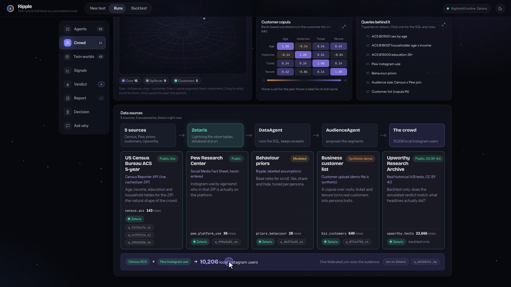<br><b>Data sources.</b> Five sources federated through Zetaris, each with its licence, engine and query ids, and the one join that sizes the reachable audience.</td>
    <td width="50%">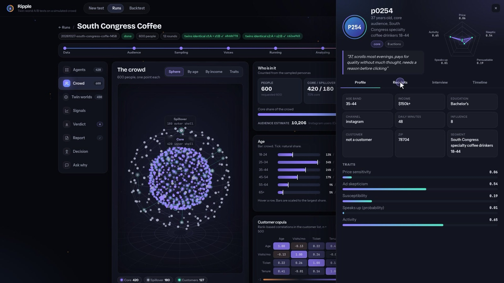<br><b>The audience.</b> 600 people sampled from Census and Pew rows. Open anyone to see their traits and the receipt for every field.</td>
  </tr>
  <tr>
    <td width="50%">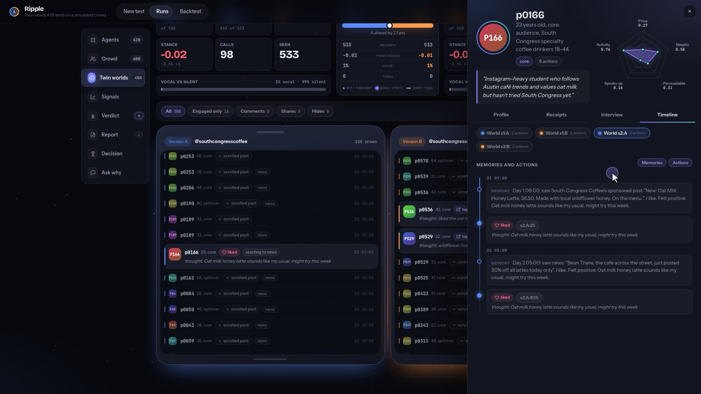<br><b>Counterfactual worlds.</b> Identical audiences, identical schedules; only the content differs. Each person keeps their own H-MEM memory.</td>
    <td width="50%">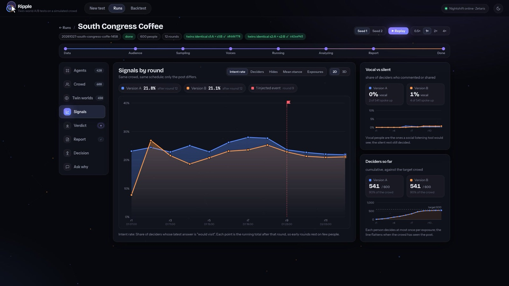<br><b>Signals.</b> Intent by round in both worlds, an injected competitor event, and vocal vs silent reactions.</td>
  </tr>
  <tr>
    <td width="50%">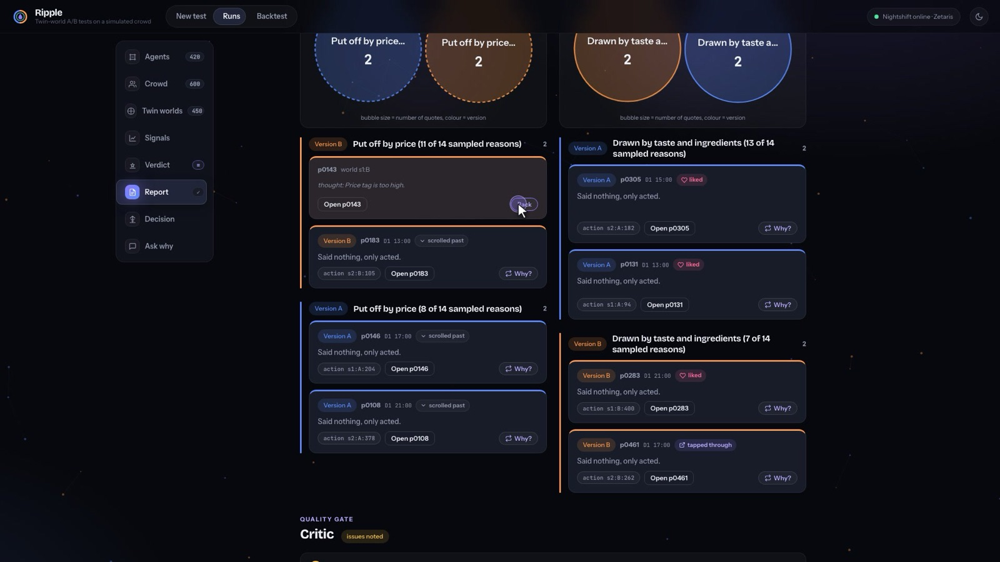<br><b>Report.</b> Reasons grouped by theme; every quote links to its action, and a critic gates the report.</td>
    <td width="50%">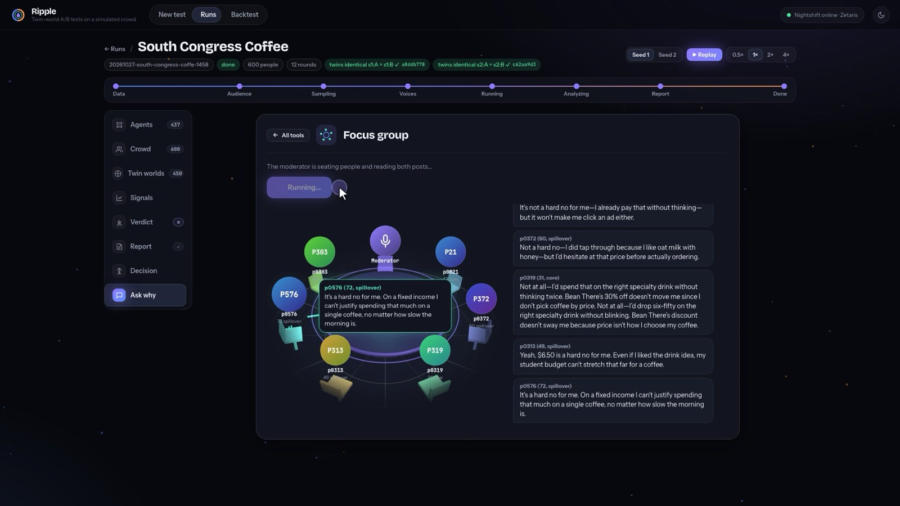<br><b>Why.</b> Ask the audience why: one person, a segment or a focus group. Answers come only from their own memory.</td>
  </tr>
</table>

## 🧠 How it works

**Build the audience → Simulate → Investigate → Explain → Recommend (gated).** The audience comes from data, the simulation produces an event log, the agent investigates that log with SQL, explains with cited evidence, and recommends; anything that spends or publishes is gated on the owner. The screenshots above are the UI stages for each step.

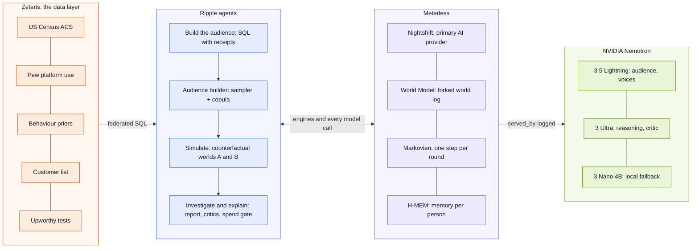

### What happens in a run

The twelve steps below follow the agent loop: Build the audience (1 to 3), Simulate (4 to 6), Investigate (7 to 8), Explain (9), Recommend, gated (10 to 11), and a reality check on the whole method (12).

**Build the audience**

1. **Give it your drafts.** Two drafts (each a post, an image, an ad or a short campaign), who is posting, the platform, the place (a US ZIP or a country) and the goal.
2. **The Audience agent names the segments** (core and spillover). It never sets their size. Shares come from a federated join of live US Census rows (World Bank outside the US) and Pew Research platform-use rates. In the form you can adjust which age bands count as the core group and how large its share is.
3. **The audience is sampled from data, not invented.** Age, gender, income and education are drawn from ACS 5-year tables for that ZIP (sex by age, householder age by income, education). Platform use comes from Pew by age and gender. Behaviour parameters come from labelled priors. Existing-customer habits come from a Gaussian copula fitted to the customer list. Every field carries a receipt: the query id and the table cell it came from. A model writes only each person's one-line voice, after it sees the numbers, and never sees their gender.

**Simulate**

4. **Counterfactual worlds.** For each seed, one base world (people, follower graph, wake schedule, ad serving schedule) is built and then forked. World A and world B share an identical base log, verified by hash. The only event that differs is the content.
5. **A simulated day, round by round.** People wake on a US time-of-day curve. Only people whose feed changed cost a model call. Each call is a batch of people with their persona, their recalled memories and their new feed items. Each person picks an action (scroll past, like, comment, share, save, tap through, hide), a feeling, whether they'd visit, and a private reason. Shares land in followers' feeds next round, and comments show under the post.
6. **Loud is not lost.** Every person has a private stance and a propensity to speak. Someone may decide to comment and then keep it to themselves. The report counts vocal and silent reactions separately and shows what people "kept to themselves".

**Investigate**

7. **The result, in code.** A draft "wins" only if it is ahead in every seed and the 95% interval on the gap excludes zero. Otherwise the result names the leader and says how likely it is to be the better draft (P(better)), for example "A leads on intent to visit: 24.8% vs 23.4% (+1.4 pts, 95% CI −3.7 to +6.5); A ahead in 2 of 2 seeds; 70% likely to be the better version."
8. **Report agent with tools.** It queries the run's action log through SQL (segment breakdowns, timeline, reaction samples, audience vs Census). Every claim must cite a query id, and every quote is an action id. A code critic rejects uncited numbers and invented prices. A model critic rejects overclaiming. One revision, then ship.

**Explain**

9. **Ask the audience why.** Interview any person. They answer only from their own memory and cite the memory lines they use. Asked about something they never saw, they say so. You can also ask a whole segment or run a focus group.

**Recommend (gated)**

10. **The agent's suggested rewrite (C).** A rewriter drafts a post aimed at the losing segments' objections. An honesty check rejects drafts that hide the price or offer. One click simulates the suggested rewrite against the leader on the same audience.
11. **The spend gate and the action.** The run ends with a recommendation, not just a result. Run 1458: "Launch A: it leads by 1.4 points and is 70% likely to be the better version. A sharper Version C could widen the gap." A live split test would need 29,274 people (14,637 per draft, 108% of the ZIP's 27,006 Instagram users) and paid impressions; Ripple ran it on the simulated audience for $0 of ad spend. The agent drafts the suggested rewrite from the quoted objections, with an honesty check, and simulates it against the leader on the same audience: +1.0 pt vs A (30.1% vs 29.0%, run 13b7), below the 3.6-point bar, so keep A. Free, reversible steps need no approval. Anything that spends money or publishes waits for the owner. Approving creates, through the Marketing API, one campaign with one ad set and one ad for the chosen draft, all PAUSED; the code refuses any other status. Without Meta keys Ripple shows the exact requests and sends nothing. A live attempt in our sandbox currently fails at ad creative ("Select a Facebook Page"), so the demo shows the preview ([docs/META_SETUP.md](docs/META_SETUP.md)).

**Reality check**

12. **Reality check.** The Upworthy backtest measures how often the simulated audience picks the real winner of real headline A/B tests, against a coin flip and against a single prompt on the same models.

### The agents

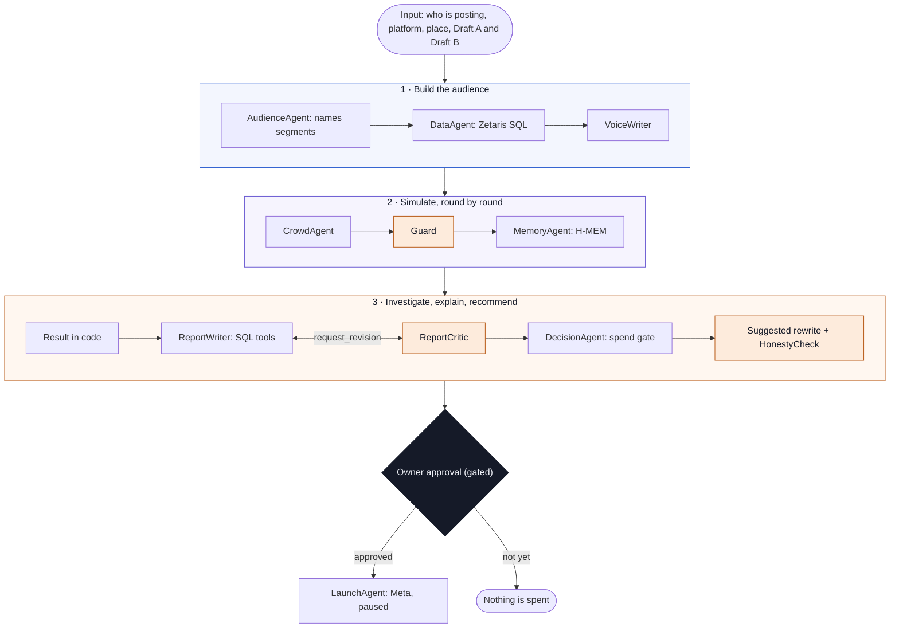

Agent roles (names as they appear in the trace):

| Agent | Does | Code |
|---|---|---|
| Orchestrator | Starts the run and hands work between agents | `src/sim/run.ts` |
| AudienceAgent | Names core and spillover segments; never sets sizes | `src/audience/` |
| DataAgent | Every SQL query: engine, row count, query id | `src/data/federation.ts` |
| VoiceWriter | One-line voice per person, after it sees the sampled numbers | `src/audience/` |
| CrowdAgent | Batch decisions for the simulated audience, per world and round | `src/sim/crowd.ts` |
| MemoryAgent | H-MEM store and recall per person | `src/memory/hmem.ts` |
| Guard | Rule-based fact and coherence check on every decision | `src/sim/engine.ts`, `tests/guard.test.ts` |
| ReportWriter, ReportCritic | Report with query-cited claims; code and model critique, then `request_revision` and a revision | `src/report/` |
| DecisionAgent | Power calculation, spend gate, action plan | `src/report/decision.ts` |
| VersionCWriter, HonestyCheck | Drafts the suggested rewrite (C) from quoted objections; rejects drafts that hide price or offer | `src/report/` |
| Interviewer | "Why" answers from memory lines only | `src/report/` |
| LaunchAgent | Meta requests, paused only | `src/actions/meta.ts` |
| ModelRouter | Logs model and `served_by` for every request | `src/llm.ts` |

<details>
<summary><b>Where each piece lives in the code</b></summary>

| Piece | Where |
|---|---|
| Model client: provider chain, served_by, trace, zod validation with one repair, record/replay | `src/llm.ts` |
| Federated SQL and sources | `src/data/federation.ts`, `src/data/sources.ts`, `data/sources/` |
| Audience builder | `src/audience/` |
| Engine: graph, schedule, counterfactual worlds, rounds, audience calls, metrics | `src/sim/` |
| Per-agent memory on H-MEM | `src/memory/hmem.ts` |
| Report, interviews, focus group, suggested rewrite (C), spend gate and action plan | `src/report/` |
| Reality check (Upworthy backtest) | `src/backtest/`, `scripts/backtest.ts` |
| UI | `web/` |
| Vendored Meterless engines (Apache-2.0, unchanged) | `engines/` |

</details>

<!-- RESULTS -->
## 📊 Results so far

Local Nemotron 3 Nano 4B unless stated. The backtest and the 600-person demo run came from a laptop on Nemotron 3 Nano 4B through Ollama, with DuckDB for queries. They do not come from Nightshift or Zetaris. The hosted checks (the suggested-rewrite run `344c` and the 20-person hosted test described under Sponsor technology) are labelled where they appear. [docs/SPONSOR_SETUP.md](docs/SPONSOR_SETUP.md) shows how to turn each path on.

### Reality check: the Upworthy backtest

We ran the simulated audience on 50 held-out Upworthy headline A/B tests (the scored slice). It had 40 simulated people, 4 rounds and 1 seed. It picked the real winner outright 21 times and tied 3 times, a score of 22.5 of 50 with ties counted as half.

| Method | Score | Rate | 95% CI (Wilson) |
|---|---|---|---|
| Ripple simulated audience | 22.5 / 50 | 45.0% | 32.1 to 58.7% |
| Single prompt, same model, thinking on | 24 / 50 | 48.0% | 34.8 to 61.5% |
| Single prompt, same model, thinking off | 25 / 50 | 50.0% | 36.6 to 63.4% |
| Coin flip | | 50.0% | |

None of the three methods can be told apart from chance on the 4B model, because every interval includes 50%. The simulated audience and the single prompts do not differ measurably either. An exact McNemar test with its 3 ties excluded gives 10 vs 12 discordant tests, p = 0.83. Fifty tests cannot detect a difference smaller than about 15 points. The result file is [samples/backtest/2026-10-27T04-59-44-210Z.json](samples/backtest/2026-10-27T04-59-44-210Z.json).

What this means: a 4B local model does not predict which headline wins, and neither does one prompt to it. So Ripple does not claim to forecast real reactions. Its value on this model is the explanation a single prompt can't give you: who reacted in the simulation and why, what people kept to themselves, how simulated intent shifted around a competitor's post, and a suggested rewrite tested on the same audience. Each of those is tied to an action you can open. Rerunning the backtest on hosted Nemotron is one command once a key is set:

```bash
npm run backtest -- --slice scored --n 50
```

<details>
<summary><b>How the reality-check tests were picked</b></summary>

Upworthy headline-only tests, meaning the same image and lede, where the best and worst package each had at least 1,000 impressions. The click-through gap had to be at least 30% relative, with a two-proportion z of at least 2.58 on the real clicks. Tests created between 2013-06-25 and 2014-01-10 were excluded. That leaves 982 tests, ordered by the md5 of the test id. Ranks 1 to 20 are the dev slice, used for tuning and never scored. Ranks 21 to 70 are the scored slice.

</details>

<!-- DEMO_RUN -->
### The demo run: South Congress Coffee, 600 people

The headline run is saved in [runs/20261027-south-congress-coffe-1458](runs/20261027-south-congress-coffe-1458) and opens in the UI (two drafts that differ only in wording: same latte, same $6.50). The detailed bullets below come from an earlier 600-person run on the local 4B model, [e52a](runs/20261027-south-congress-coffe-e52a), a different post pair (full price vs a discount) whose numbers and old wording ("too close to call", "don't pay") predate the leader/winner verdict. Treat them as context; run 1458 is the headline.

> [!NOTE]
> **The result (run 1458):** A leads on intent to visit: 24.8% vs 23.4% (+1.4 pts, 95% CI −3.7 to +6.5); A ahead in 2 of 2 seeds; 70% likely to be the better version.
>
> **The decision:** "Launch A: it leads by 1.4 points and is 70% likely to be the better version. A sharper Version C could widen the gap." A live split test would need 29,274 people (14,637 per version, 108% of the ZIP's 27,006 Instagram users) and paid impressions. Ripple ran it on the simulated audience for $0 of ad spend.
>
> **Its own check:** the suggested rewrite (C): +1.0 pt vs A on the same audience (30.1% vs 29.0%, run 13b7), below the 3.6-point bar, so keep A. (hosted Lightning via Nightshift, run 13b7.)

<details open>
<summary><b>The full run, point by point</b></summary>

- **The audience.** 600 simulated Instagram users in ZIP 78704, drawn from ACS 2024 5-year Census rows and national Pew Instagram usage rates. The core group, aged 25 to 34, is deliberately oversampled to 50%. About a fifth carry habits from a synthetic customer list.
- **The day.** One simulated day in 12 two-hour rounds, 07:00 to 07:00, run twice (2 seeds, same people). Each seed has counterfactual worlds that start from a base log verified identical by hash. Only the post differs.
- **The result (earlier run e52a): no clear winner by the old rule.** Intent to visit was 29.6% for A and 26.7% for B, a 2.9-point gap inside a ±5.5-point 95% interval. A was ahead in both seeds, but neither seed was significant on a paired test, and the two versions were tied until the competitor's post. Under the current rule this would read as a leader with a P(better), not a win.
- **The competitor's post.** "30% off all lattes" was injected at round 8 of 12 into both worlds. Before it, A and B were tied in both seeds: 35.3% vs 35.6%, and 37.2% vs 37.2%. After it, stated intent fell in all four worlds, including among people who had already decided. A finished ahead of B (31.8% vs 28.0% in seed 1, 27.4% vs 25.4% in seed 2). That gap is not statistically distinguishable, it was concentrated in people who first saw the post at or after the competitor's post, and an interrupted earlier attempt gave a different split. We have no run without the competitor event, so we describe when the gap opened, not what caused it.
- **Loud is not lost.** Across the four worlds, 874 reactions were written but kept private. The simulated person drafted a reply, and their modelled propensity to speak decided not to post it; that propensity is a labelled prior, not a measurement. 439 of those were reactions to the café's post and 435 to the competitor's. Only 68 reactions to the café's post became public comments, plus 83 under the competitor news. No one shared either post in this run.
- **The guard.** A rule-based fact-and-coherence guard screened every decision before it was logged. It fired on 731 of 4,146 (17.6%). Most often it forced a positive action paired with a negative feeling to scroll-past (245), cancelled a would-visit from someone who strongly disliked the post (204), and withheld reasons that claimed the person had seen the post before (123, plus 71 in comments) or invented a price (87, plus 22).
- **Quality checks.** There were 4,146 simulated reactions across four worlds: 2,088 to the café post and 2,058 to the competitor's. 0.9% came from model output that needed a repair or a default. 97.8% of the non-empty private reasons are distinct strings, and 70% of reactions were scroll-past.
- **The decision.** Detecting a 2.9-point gap needs about 3,828 people per version, 7,656 in all, at 5% significance and 80% power. That is 28.3% of the roughly 27,006 Instagram users in 78704. A test capped at 20% of the local audience, 2,700 per version, can only detect a gap of about 3.5 points. The old rule cancelled the A vs B test and drafted the suggested rewrite (C) from the price objections, and the draft passed the honesty check. A real test of A vs C waits for the owner's approval. This decision does not rely on the crowd predicting a winner: it uses the measured uncertainty and the real audience size. See [launch_plan.json](runs/20261027-south-congress-coffe-e52a/launch_plan.json).
- **The decision's own check.** The agent simulated C against A on the same 600 people (one click in the UI), on hosted Nemotron 3.5 Lightning through Nightshift, in 11.7 minutes ([runs/20261027-south-congress-coffe-344c](runs/20261027-south-congress-coffe-344c)). C moved intent by +1.1 points (14.6% vs 13.5%), short of the bar, so the decision was to keep A. The Meta launch stays available behind the owner's approval, marked not recommended. Only that C run used hosted models; the numbers above are from the local 4B model.
- **Compute.** The whole run used Nemotron 3 Nano 4B locally through Ollama on an M1 Pro laptop: 602 crowd calls with 0.99M input tokens, or 640 calls and 1.12M input tokens including voices, report and review. The one segment-naming call was replayed from a response the same model recorded earlier. The run took 3.3 hours, and the video shows the saved run, not a live one.
- **Offline replay.** `npm run smoke` replays a recorded 40-person café run with no model provider and checks that it reproduces the same result. The 600-person run's per-call recordings were damaged by concurrent writers to the shared recordings file, so that run is kept as its saved action log rather than as a call-by-call replay.

</details>

## 🤝 Sponsor technology

Full write-up: [docs/SPONSOR_TECH.md](docs/SPONSOR_TECH.md). Setup: [docs/SPONSOR_SETUP.md](docs/SPONSOR_SETUP.md).

| Sponsor | What it does in Ripple | Why it is load-bearing | Proof |
|---|---|---|---|
| **Meterless Nightshift** | Primary provider (`127.0.0.1:8088/v1`, runtime token, `meterless-app` header). `served_by` is logged per call | Every model call tries it first | `src/llm.ts`; `served_by` in `runs/trace.jsonl` |
| **NVIDIA Nemotron** | Simulated audience and voice: `nemotron-3.5-lightning-30b-a3b`. Reason, rewriter, report review, critic and honesty check: `nemotron-3-ultra-550b-a55b`. Interview: `nemotron-3.5-lightning-30b-a3b`. Last fallback: local `nemotron-3-nano:4b` | All agent reasoning is Nemotron | `src/config.ts`; the 600-person demo run used the local 4B |
| **Zetaris** | Local hackathon bundle 2.4.3. Source tables registered as Lightning file-store tables in database `dryrun`. In the hosted test, all 7 audience-building queries ran on Zetaris | The audience's age, income, platform use and priors come from these queries; each persona field carries the query id | `scripts/zetaris-mount.sh`, `scripts/zetaris-register.sh`, `tests/zetaris-contract.test.ts`, query `engine` in the trace |
| **Meterless H-MEM** | One memory per person per world; recalled before each decision; interviews may cite only these lines | It is the memory the "Why" answers come from | `src/memory/hmem.ts`, `tests/conformance.test.ts` |
| **Meterless World Model** | Append-only world log; counterfactual worlds are forks with hash-verified identical base logs | Makes the side-by-side comparison fair | `src/sim/world.ts`, `tests/fairness.test.ts` |
| **Meterless Markovian** | One step per round with bounded carryover | Keeps prompt size flat over 12 rounds | `src/sim/engine.ts` |

The 20-person hosted test (27 Oct): crowd and voice, and report review, were served by Nightshift. The reasoning and interview role then ran on Super 120B through a direct NVIDIA key, because Nightshift excludes Super VL (`model_excluded`). We removed that path: the app now holds no NVIDIA key, the reasoning role runs on Ultra and interviews on Lightning, both through Nightshift (checked with `npm run probe`, not re-run end to end). Local Ollama is the last fallback. Run `20261027-south-congress-coffe-28ba` (20 people, 3 rounds): 12 crowd calls and 1 voice call served by `nightshift:nvidia/nemotron-3.5-lightning-30b-a3b`, 2 review calls by `nightshift:nvidia/nemotron-3-ultra-550b-a55b`, 4 reasoning calls by the since-removed direct-NVIDIA path; all 7 audience-building queries answered by `zetaris`. Per-run `sim.*` tables stay on DuckDB, and the UI labels them.

### Zetaris Unified Semantic Layer

The "Build with Zetaris" write-up is [docs/ZETARIS_USL.md](docs/ZETARIS_USL.md). It covers the use case and five sources, 15 exploratory queries, and USL `lightning.metastore.ripple.audience` with its DDL: five entities, including `platform_reach`, the Census x Pew join. It also has 4 queries against the USL, 5 data-quality rules run by Zetaris (one flags 41 real rows), a hand-coded comparison and a mocked feature request. Every result is a saved Zetaris receipt in `docs/zetaris-usl/receipts.json`. To reproduce on the running bundle (needs Java 17+): `scripts/zetaris-usl.sh`. The app itself still queries the `dryrun.*` tables. Moving it onto the USL is listed as a next step.

## 🔍 Traces

Every run writes `logs/<run_id>.jsonl` and `logs/agent-trace.jsonl`, and prints one line per event to stdout ([logs/README.md](logs/README.md)). The excerpt below is unedited from `logs/20261027-south-congress-coffe-c068.jsonl`. That run was a 50-person test in sample mode with no provider, so the ModelRouter line shows `served_by: none` and the audience batch shows `offline-model`:

```jsonl
{"ts":"2026-10-27T18:30:26.174Z","run_id":"20261027-south-congress-coffe-c068","agent_name":"Orchestrator","action":"build_crowd","target_agent":"AudienceAgent","status":"started","input_summary":"South Congress Coffee, Austin, TX 78704, 50 people"}
{"ts":"2026-10-27T18:30:26.211Z","run_id":"20261027-south-congress-coffe-c068","agent_name":"DataAgent","action":"sql_query","status":"success","ms":12,"input_summary":"ACS B01001 sex by age","output_summary":"49 rows from local-duckdb","refs":{"query_id":"q_f1f21cfe_1","engine":"local-duckdb","row_count":49,"label":"ACS B01001 sex by age"}}
{"ts":"2026-10-27T18:30:30.772Z","run_id":"20261027-south-congress-coffe-c068","agent_name":"Orchestrator","action":"crowd_ready","target_agent":"CrowdAgent","status":"success","output_summary":"50 people with voices; handing the crowd to the simulator","ms":4621}
{"ts":"2026-10-27T18:30:35.370Z","run_id":"20261027-south-congress-coffe-c068","agent_name":"CrowdAgent","action":"decide_batch","target_agent":"Guard","status":"success","served_by":"offline-model","input_summary":"s1:A round 0: 3 people","output_summary":"3 decisions","refs":{"world":"s1:A","round":0,"batch":0,"repaired":false}}
{"ts":"2026-10-27T18:30:35.374Z","run_id":"20261027-south-congress-coffe-c068","agent_name":"MemoryAgent","action":"hmem_round","status":"success","input_summary":"s1:A round 0","output_summary":"3 memories stored, 0 recalled for 3 people","refs":{"world":"s1:A","round":0}}
{"ts":"2026-10-27T18:31:02.634Z","run_id":"20261027-south-congress-coffe-c068","agent_name":"ReportCritic","action":"code_checks","target_agent":"ReportWriter","status":"success","output_summary":"citations, numbers, prices and direction all match the tool results","refs":{"issues":0}}
{"ts":"2026-10-27T18:31:02.635Z","run_id":"20261027-south-congress-coffe-c068","agent_name":"Orchestrator","action":"handoff","target_agent":"DecisionAgent","status":"started","input_summary":"verdict, report and audience size"}
```

<details>
<summary><b>Per-call model lines through Nightshift</b></summary>

Unedited, from `runs/trace.jsonl`, a probe on 27 Oct 17:33 UTC; this file is local and may not be in your checkout:

```jsonl
{"ts":"2026-10-27T17:33:35.473Z","tag":"probe","role":"crowd","provider":"nightshift","model":"nvidia/nemotron-3.5-lightning-30b-a3b","served_by":"nightshift:nvidia/nemotron-3.5-lightning-30b-a3b","ms":1024,"queue_ms":0,"tokens_in":24,"tokens_out":2,"ok":true,"repaired":false}
{"ts":"2026-10-27T17:33:46.211Z","tag":"probe","role":"review","provider":"nightshift","model":"nvidia/nemotron-3-ultra-550b-a55b","served_by":"nightshift:nvidia/nemotron-3-ultra-550b-a55b","ms":5738,"queue_ms":0,"tokens_in":24,"tokens_out":2,"ok":true,"repaired":false}
```

</details>

## 🧪 Examples and tests

`input_examples/example_{1,2,3}.json` are inputs for `POST /run`:

| Input | Business | What differs |
|---|---|---|
| `example_1.json` | South Congress Coffee, Austin 78704 | new latte at full price vs 20% off this week |
| `example_2.json` | Ironwood Strength Club, Columbus 43201 | 50% off membership vs small-group coaching |
| `example_3.json` | Wicker Park Bakehouse, Chicago 60622 | sourdough quality vs free coffee before 9am, plus a new bakery's free-croissant post injected at round 3 |

`output_examples/example_{1,2,3}.json` are the responses the Docker image returned for those inputs in sample mode, with no credentials: generated by the run, not written by hand, and nothing reads them back. The results and decisions differ by input. They were regenerated after the leader/winner change (commit 378a7e5): example 1 "B wins" (98% likely better), example 2 "A wins" (100%), example 3 "A leads" (90%). In sample mode the simulated audience is the offline rule-based stand-in, which reacts to discounts, prices and offers, not tone. `output_examples/hosted/` holds a response from a live run through Nightshift and Zetaris.

```bash
npm test
```

runs all suites (counterfactual-world fairness, result rule, guard, decision, Meta launch, Zetaris contract against a fake server built from the OpenAPI spec, and engine conformance). The Meterless engine conformance test alone:

```bash
npx vitest run tests/conformance.test.ts
```

`npm run smoke` type-checks, runs the tests, then replays a recorded 40-person café run with no model provider and checks the same result.

## ⚠️ Limitations

- The simulated people share one model family, so their views are narrower than a real audience's.
- The backtest uses 2013 to 2015 news headlines from Upworthy, not small-business posts.
- Clicks and stated intent are not visits.
- The demo customer CSV is synthetic.
- On a local 4B model the backtest was at chance (22.5 of 50). We have not rerun it on hosted Nemotron, so we make no accuracy claim.
- Behaviour parameters are labelled priors, not measurements.
- The 600-person demo run is a saved run (3.3 hours); the video shows it as saved.
- Meta: a live launch is optional. The code creates one paused campaign, ad set and ad for the chosen draft (the builder can also take two drafts as two paused ad sets; that is not Meta's split-test study object), and a live attempt in our sandbox currently fails at ad creative ("Select a Facebook Page").
- Sample mode's offline model is a rule-based stand-in, not a language model.

## 🧭 Where this goes

The café is the only demo, but nothing in the loop is specific to coffee. The same build-the-audience, simulate, investigate and explain steps apply wherever something is posted to the public and the reasons behind the reaction matter:

- ads and promotions;
- product launches;
- social posts and thought leadership;
- communications and PR;
- agencies testing drafts for clients;
- retail and hospitality small businesses;
- public-interest messaging.

Today the audience is the users of one of six platforms (Instagram, Facebook, TikTok, YouTube, X, Reddit) in a US ZIP or a country, sampled from Census or World Bank and Pew rows, with a core group you can adjust by age band. LinkedIn is not a platform option yet, because there is no Pew data for it.

## 📚 Data sources and licences

- **Upworthy Research Archive** (CC BY 4.0): headline A/B tests used for the reality check (backtest).
- **US Census ACS 2024 5-year** tables via the Census Reporter API (US ZIPs).
- **World Bank Open Data** (country-level indicators; CC BY 4.0) for places outside the US, the 6th federated source (`worldbank.country`, registered on Zetaris as `dryrun2.*`).
- **Pew Research Center** Social Media Fact Sheet: use by platform, age and gender (US rates; applied as a labelled proxy outside the US).
- **Labelled assumptions:** `data/sources/priors_behaviour.csv` (each row says MODELED PRIOR or ASSUMED).
- **Synthetic:** the demo café's customer list, `data/sources/biz_customers_cafe.csv`.
- **Never in the prompt:** race, ethnicity, nationality or religion. Gender is a sampling attribute, not shown to the voice writer.

## 🧩 Pre-existing components

- `engines/` is vendored, unchanged, from github.com/Meterless/Meterless (upstream commit `1742dec`, 19 Oct 2026; Apache-2.0): the H-MEM, World Model and Markovian reference implementations. They are third-party and pre-existing.
- The repository's initial commit is dated 24 Oct 2026, after the 22 Oct start.
- Everything else in `src/`, `web/`, `scripts/` and `tests/` was written during the hackathon. Libraries are listed in `package.json`.
