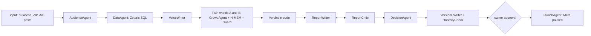

# Ripple

**Test your post on a simulated crowd before you spend a dollar.**

Ripple A/B tests an ad, post or announcement on a simulated crowd sampled from the audience it targets. Two identical crowds see version A and version B. You watch both feeds fill live, then get the winner with a margin (or "too close to call"), who preferred which version and why in their own words, and a version C. The agent also decides whether a real paid test could tell the two posts apart at the audience size the business can reach. If not, it says so, and nothing is spent until the owner approves. It is not a prediction of real customer behaviour, and on our backtest it did not beat chance (see Results).

Built for the Open Agent Hackathon 2026, Track 3 (Reasoning Architecture) and the NVIDIA Nemotron award. Sponsor tech: NVIDIA Nemotron, Meterless (Nightshift and the H-MEM, World Model and Markovian engines), Zetaris. Details: [docs/SPONSOR_TECH.md](docs/SPONSOR_TECH.md).

## Quick start for judges

Three paths. Pick the one that matches what you have.

**1. Docker, sample mode, no credentials.**

```bash
docker build -t oah-submission .
```

```bash
docker run --rm -p 8000:8000 -e SAMPLE_MODE=true oah-submission
```

Verified on 27 Oct from a fresh clone: the image builds, and with no `.env`, no Zetaris and no Nightshift all three `input_examples` return a full result (verdict, report, spend decision) in about a second each. In that mode the crowd is the offline persona model and the trace says so (`served_by: offline-model`).

**2. Docker with Nightshift and Zetaris on the host.** Start Nightshift and the Zetaris bundle on your machine first ([docs/SPONSOR_SETUP.md](docs/SPONSOR_SETUP.md)), fill `.env`, point the base URLs at `host.docker.internal`, then:

```bash
docker run --rm -p 8000:8000 --env-file .env oah-submission
```

Set `NIGHTSHIFT_BASE_URL=http://host.docker.internal:8088/v1`, `ZETARIS_BASE_URL=http://host.docker.internal:8888` and `OLLAMA_BASE_URL=http://host.docker.internal:11434` in `.env`, and mount the Zetaris table registry so the container knows which tables Zetaris serves: add `-v "$PWD/data/cache/zetaris-registered.json:/app/data/cache/zetaris-registered.json:ro"`. `docker run --env-file` does not accept inline comments, so strip comment lines from `.env` first. Verified on 27 Oct with `npm run probe` inside the container: crowd and review served by `nightshift:nvidia/...`, reasoning by direct NVIDIA, federated engine `zetaris`.

**3. Node, with the UI.**

```bash
npm ci && npm start
```

Open http://localhost:8787 and press **Load example**. With nothing set it uses local Nemotron through Ollama (`ollama pull nemotron-3-nano:4b`).

**Call the API.** `POST /run` takes JSON in and returns JSON out for one full A/B run (`GET /health` checks the server). In Docker it is on port 8000; with `npm start`, use port 8787 (`PORT` in `.env`).

```bash
curl -X POST http://localhost:8000/run -H "Content-Type: application/json" -d @input_examples/example_1.json
```

### Entry points

| Entry | What |
|---|---|
| `POST /run`, `GET /health` | Judges' programmatic entry: structured input, structured output ([src/runApi.ts](src/runApi.ts), routes in [src/api.ts](src/api.ts)) |
| `http://localhost:8787` | The UI: new test form, live run, stages Agents, Crowd, Twin worlds, Signals, Verdict, Report, Decision, Ask why |
| `npm run run:ab -- --crowd 120 --rounds 12 --seeds 2` | A/B run from the command line |
| `npm run backtest -- --slice scored --n 50` | Upworthy backtest |
| `npm run probe` | Checks every provider, source and the federation engine |

`POST /run` limits (from the input schema): `crowd` 20 to 300 (default 60), `rounds` 6 to 32 (default 8), `seeds` 1 to 3, a 5-digit `zip` (or an `address` that contains one), a run timeout of 10 minutes (`RUN_TIMEOUT_MS`).

### `.env` variables

Copy `.env.example` to `.env`. Everything is optional; values below are placeholders.

| Variable | Meaning |
|---|---|
| `PROVIDERS=nightshift,nvidia,ollama` | Order of model providers per call |
| `NIGHTSHIFT_BASE_URL=http://127.0.0.1:8088/v1`, `NIGHTSHIFT_TOKEN=<runtime token>` | Nightshift proxy. If the token is unset it is read from Nightshift's `proxy-token` file |
| `NVIDIA_API_KEY=<nvapi-...>`, `NVIDIA_RPM=38` | Direct NVIDIA fallback |
| `OLLAMA_BASE_URL=http://127.0.0.1:11434` | Local `nemotron-3-nano:4b` |
| `ZETARIS_BASE_URL`, `ZETARIS_API_KEY` or `ZETARIS_USER`+`ZETARIS_PASSWORD`, `ZETARIS_ORG_ID`, `ZETARIS_FILE_ROOT` | Zetaris Lightning. Blank means local DuckDB, labelled |
| `SAMPLE_MODE=true` | Replay mode (below) |
| `RECORD=true` | Record model answers for later replay |
| `META_ACCESS_TOKEN`, `META_AD_ACCOUNT_ID`, `META_PAGE_ID`, `META_INSTAGRAM_USER_ID`, `META_LINK_URL`, `META_DAILY_BUDGET_CENTS` | Optional Meta launch ([docs/META_SETUP.md](docs/META_SETUP.md)). Unset means preview only |
| `PORT=8787` | UI and API port |

### Sample mode, honestly

`SAMPLE_MODE=true` needs no credentials. For each model call, Ripple first looks for an exact recorded answer for the same prompt in `samples/recordings.sqlite` and replays it (`served_by: replay(...)`). If none matches, the crowd decisions come from an offline persona-driven decision model ([src/sim/offline.ts](src/sim/offline.ts)). It scores each person's sampled traits (price sensitivity, skepticism, customer status, role, activity, age) against features parsed from the post text (discount, price, new, local, urgency), with seeded randomness. Its answers are real logic on your input and are logged `served_by: offline-model`. They are not a language model's reading of the post. Census rows fall back to cached geographies when the API is unreachable. With no model at all, the report is the code-built fallback (`report.fallback: true`), Version C is skipped with a logged error ("No model provider answered"), and short runs recall few or no H-MEM lines, because the offline model does not read memories. The trace marks each of these. A sample-mode result shows the pipeline working; it is not evidence about your posts.

<!-- RESULTS -->
## Results so far (local Nemotron 3 Nano 4B unless stated)

The backtest and the 600-person demo run came from a laptop on Nemotron 3 Nano 4B through Ollama, with DuckDB for queries. They do not come from Nightshift or Zetaris. The hosted checks (the Version C run `344c` and the 20-person hosted test described under Sponsor technology) are labelled where they appear. [docs/SPONSOR_SETUP.md](docs/SPONSOR_SETUP.md) shows how to turn each path on.

**Reality check: the Upworthy backtest.** We ran the crowd on 50 held-out Upworthy headline A/B tests (the scored slice). The crowd had 40 simulated people, 4 rounds and 1 seed. It picked the real winner outright 21 times and tied 3 times, a score of 22.5 of 50 with ties counted as half.

| Method | Score | Rate | 95% CI (Wilson) |
|---|---|---|---|
| Ripple crowd | 22.5 / 50 | 45.0% | 32.1 to 58.7% |
| Single prompt, same model, thinking on | 24 / 50 | 48.0% | 34.8 to 61.5% |
| Single prompt, same model, thinking off | 25 / 50 | 50.0% | 36.6 to 63.4% |
| Coin flip | | 50.0% | |

None of the three methods can be told apart from chance on the 4B model, because every interval includes 50%. The crowd and the single prompts do not differ measurably either. An exact McNemar test with the 3 crowd ties excluded gives 10 vs 12 discordant tests, p = 0.83. Fifty tests cannot detect a difference smaller than about 15 points. The result file is [samples/backtest/2026-10-27T04-59-44-210Z.json](samples/backtest/2026-10-27T04-59-44-210Z.json).

How the tests were picked: Upworthy headline-only tests, meaning the same image and lede, where the best and worst package each had at least 1,000 impressions. The click-through gap had to be at least 30% relative, with a two-proportion z of at least 2.58 on the real clicks. Tests created between 2013-06-25 and 2014-01-10 were excluded. That leaves 982 tests, ordered by the md5 of the test id. Ranks 1 to 20 are the dev slice, used for tuning and never scored. Ranks 21 to 70 are the scored slice.

What this means: a 4B local model does not predict which headline wins, and neither does one prompt to it. Ripple's value on this model is the parts a single prompt can't give you. You get who reacted and why, what people kept to themselves, how a competitor's post moved intent, and a version C tested on the same crowd. Each of those is tied to an action you can open. Rerunning the backtest on hosted Nemotron is one command once a key is set:

```bash
npm run backtest -- --slice scored --n 50
```

<!-- DEMO_RUN -->
**The demo run: South Congress Coffee, 600 people.** The run is saved in [runs/20261027-south-congress-coffe-e52a](runs/20261027-south-congress-coffe-e52a) and opens in the UI.

- **The crowd.** 600 simulated Instagram users in ZIP 78704, drawn from ACS 2024 5-year Census rows and national Pew Instagram usage rates. The core group, aged 25 to 34, is deliberately oversampled to 50%. About a fifth carry habits from a synthetic customer list.
- **The day.** One simulated day in 12 two-hour rounds, 07:00 to 07:00, run twice (2 seeds, same people). Each seed has twin worlds that start from a base log verified identical by hash. Only the post differs.
- **The verdict: too close to call.** Intent to visit was 29.6% for A and 26.7% for B, a 2.9-point gap inside a ±5.5-point 95% interval. A was ahead in both seeds, but neither seed was significant on a paired test, and the two versions were tied until the competitor's post. We report no measurable difference between the two posts.
- **The competitor's post.** "30% off all lattes" was injected at round 8 of 12 into both worlds. Before it, A and B were tied in both seeds: 35.3% vs 35.6%, and 37.2% vs 37.2%. After it, stated intent fell in all four worlds, including among people who had already decided. A finished ahead of B (31.8% vs 28.0% in seed 1, 27.4% vs 25.4% in seed 2). That gap is not statistically distinguishable, it was concentrated in people who first saw the post at or after the competitor's post, and an interrupted earlier attempt gave a different split. We have no run without the competitor event, so we describe when the gap opened, not what caused it.
- **Loud is not lost.** Across the four worlds, 874 reactions were written but kept private. The simulated person drafted a reply, and their modelled propensity to speak decided not to post it; that propensity is a labelled prior, not a measurement. 439 of those were reactions to the café's post and 435 to the competitor's. Only 68 reactions to the café's post became public comments, plus 83 under the competitor news. No one shared either post in this run.
- **The guard.** A rule-based fact-and-coherence guard screened every decision before it was logged. It fired on 731 of 4,146 (17.6%). Most often it forced a positive action paired with a negative feeling to scroll-past (245), cancelled a would-visit from someone who strongly disliked the post (204), and withheld reasons that claimed the person had seen the post before (123, plus 71 in comments) or invented a price (87, plus 22).
- **Quality checks.** There were 4,146 simulated reactions across four worlds: 2,088 to the café post and 2,058 to the competitor's. 0.9% came from model output that needed a repair or a default. 97.8% of the non-empty private reasons are distinct strings, and 70% of reactions were scroll-past.
- **The decision.** "Don't pay to A/B test these two posts: they are too close to tell apart with the people South Congress Coffee can reach. Test a bolder version instead." Detecting a 2.9-point gap needs about 3,828 people per version, 7,656 in all, at 5% significance and 80% power. That is 28.3% of the roughly 27,006 Instagram users in 78704. A test capped at 20% of the local audience, 2,700 per version, can only detect a gap of about 3.5 points. The agent cancelled the A vs B test and drafted version C from the price objections, and the draft passed the honesty check. A real test of A vs C waits for the owner's approval. This decision does not rely on the crowd predicting a winner: it uses the measured uncertainty and the real audience size. See [launch_plan.json](runs/20261027-south-congress-coffe-e52a/launch_plan.json).
- **Compute.** The whole run used Nemotron 3 Nano 4B locally through Ollama on an M1 Pro laptop: 602 crowd calls with 0.99M input tokens, or 640 calls and 1.12M input tokens including voices, report and review. The one segment-naming call was replayed from a response the same model recorded earlier. The run took 3.3 hours, and the video shows the saved run, not a live one.

**The decision and its own check.** The demo run ends with "Don't pay to A/B test these two posts". A real test would need 3,828 people per version, 28.3% of the roughly 27,006 Instagram users in 78704, to detect a 2.9-point gap. A test capped at 20% of that audience detects about 3.5 points. The agent drafted Version C from the quoted price objections, and it passed the honesty check. The agent then simulated C against A on the same 600 people (one click in the UI), on hosted Nemotron 3.5 Lightning through Nightshift, in 11.7 minutes ([runs/20261027-south-congress-coffe-344c](runs/20261027-south-congress-coffe-344c)). C moved intent by +1.1 points (14.6% vs 13.5%), short of the bar, so the decision is to keep A and not pay for a real test of C. The Meta launch stays available behind the owner's approval, marked not recommended. Only that C run used hosted models; the numbers above are from the local 4B model.

**Offline replay.** `npm run smoke` replays a recorded 40-person café run with no model provider and checks that it reproduces the same verdict. The 600-person run's per-call recordings were damaged by concurrent writers to the shared recordings file, so that run is kept as its saved action log rather than as a call-by-call replay.

## What happens in a run

1. **Paste two versions** of a post, the business, its ZIP and the goal.
2. **The Audience agent names the segments** (core and spillover). It never sets their size. Shares come from a federated join of live US Census rows and Pew Research platform-use rates.
3. **The crowd is sampled from data, not invented.** Age, gender, income and education are drawn from ACS 5-year tables for that ZIP (sex by age, householder age by income, education). Instagram use comes from Pew by age and gender. Behaviour parameters come from labelled priors. Existing-customer habits come from a Gaussian copula fitted to the customer list. Every field carries a receipt: the query id and the table cell it came from. A model writes only each person's one-line voice, after it sees the numbers, and never sees their gender.
4. **Twin worlds.** For each seed, one base world (people, follower graph, wake schedule, ad serving schedule) is built and then forked. World A and world B share an identical base log, verified by hash. The only event that differs is the post.
5. **A simulated day, round by round.** People wake on a US time-of-day curve. Only people whose feed changed cost a model call. Each call is a batch of people with their persona, their recalled memories and their new feed items. Each person picks an action (scroll past, like, comment, share, save, tap through, hide), a feeling, whether they'd visit, and a private reason. Shares land in followers' feeds next round, and comments show under the post.
6. **Loud is not lost.** Every person has a private stance and a propensity to speak. Someone may decide to comment and then keep it to themselves. The report counts vocal and silent reactions separately and shows what people "kept to themselves".
7. **Verdict in code.** A version wins only if it wins every seed and the pooled gap is larger than the 95% confidence interval. Otherwise the answer is "too close to call".
8. **Report agent with tools.** It queries the run's action log through SQL (segment breakdowns, timeline, reaction samples, crowd vs Census). Every claim must cite a query id, and every quote is an action id. A code critic rejects uncited numbers and invented prices. A model critic rejects overclaiming. One revision, then ship.
9. **Ask why.** Interview any person. They answer only from their own memory and cite the memory lines they use. Asked about something they never saw, they say so. You can also ask a whole segment or run a focus group.
10. **Version C.** A rewriter drafts a post aimed at the losing segments' objections. An honesty check rejects drafts that hide the price or offer. One click simulates C against the winner on the same crowd.
11. **The decision and the action.** The run ends with a spend decision, not just a verdict. A power calculation on the simulated gap, against the number of Instagram users the business can actually reach (Census × Pew join), answers one question: is a real A/B test of these posts worth paying for? If not, the agent cancels it and drafts a bolder version from the quoted objections, with an honesty check. It then writes a launch plan for the test that is worth running: variants, targeting, people per version, the success metric, and the decision and stop rules. Free, reversible steps need no approval: cancelling the pointless test and drafting the new version. Simulating C against the leader on the same crowd is one click. The agent then checks the result against its own bar, the smallest gap an affordable real test could detect, and updates the decision. Anything that spends money or publishes waits for the owner's approval. Approving creates, through the Marketing API, one campaign with two ad sets (one per version, identical ZIP and age targeting, the same fixed daily budget) and one ad each, all created paused. This is two paused ad sets, not Meta's split-test study object. The code refuses any other status. Without Meta credentials Ripple shows the exact requests and sends nothing. Live launch is optional: a live attempt in our sandbox currently fails at ad creative ("Select a Facebook Page"), so the demo shows the preview ([docs/META_SETUP.md](docs/META_SETUP.md)).
12. **Reality check.** The Upworthy backtest measures how often the crowd picks the real winner of real headline A/B tests, against a coin flip and against a single prompt on the same models.

## Architecture

```
 Census Reporter REST (ACS 5-yr) ─┐
 Pew platform-use CSV ────────────┤  federated SQL (Zetaris REST client,
 behaviour priors CSV ────────────┤  local DuckDB fallback), query ids
 customer CSV (copula) ───────────┤  ──► receipts on every persona
 Upworthy archive CSV ────────────┘
                │
   Audience agent (names segments) ─► sampler + copula ─► voices (batched)
                │
   per seed: base world ─► fork ─► World A │ World B   (Meterless World Model log)
                         each round = one Markovian step (checkpointed carryover)
                         each person = own H-MEM (recall before deciding, cite in interviews)
                         crowd calls ─► Nemotron (Nightshift ─► NVIDIA ─► local Ollama)
                │
   metrics + verdict (code) ─► action log exported as sim.* tables
                │
   report agent (SQL tools) ─► code critic + model critic ─► interviews, segments, focus group, version C
```

| Piece | Where |
|---|---|
| Model client: provider chain, served_by, trace, zod validation with one repair, record/replay | `src/llm.ts` |
| Federated SQL and sources | `src/data/federation.ts`, `src/data/sources.ts`, `data/sources/` |
| Crowd builder | `src/audience/` |
| Engine: graph, schedule, twin worlds, rounds, crowd calls, metrics | `src/sim/` |
| Per-agent memory on H-MEM | `src/memory/hmem.ts` |
| Report, interviews, focus group, version C, spend decision and launch plan | `src/report/` |
| Upworthy backtest | `src/backtest/`, `scripts/backtest.ts` |
| UI | `web/` |
| Vendored Meterless engines (Apache-2.0, unchanged) | `engines/` |


### Flow



Agent roles (names as they appear in the trace):

| Agent | Does | Code |
|---|---|---|
| Orchestrator | Starts the run and hands work between agents | `src/sim/run.ts` |
| AudienceAgent | Names core and spillover segments; never sets sizes | `src/audience/` |
| DataAgent | Every SQL query: engine, row count, query id | `src/data/federation.ts` |
| VoiceWriter | One-line voice per person, after it sees the sampled numbers | `src/audience/` |
| CrowdAgent | Batch decisions per world and round | `src/sim/crowd.ts` |
| MemoryAgent | H-MEM store and recall per person | `src/memory/hmem.ts` |
| Guard | Rule-based fact and coherence check on every decision | `src/sim/engine.ts`, `tests/guard.test.ts` |
| ReportWriter, ReportCritic | Report with query-cited claims; code and model critique, then `request_revision` and a revision | `src/report/` |
| DecisionAgent | Power calculation, spend decision, launch plan | `src/report/decision.ts` |
| VersionCWriter, HonestyCheck | Drafts C from quoted objections; rejects drafts that hide price or offer | `src/report/` |
| Interviewer | Ask-why answers from memory lines only | `src/report/` |
| LaunchAgent | Meta requests, paused only | `src/actions/meta.ts` |
| ModelRouter | Logs model and `served_by` for every request | `src/llm.ts` |

## Traces

Every run writes `logs/<run_id>.jsonl` and `logs/agent-trace.jsonl`, and prints one line per event to stdout ([logs/README.md](logs/README.md)). The excerpt below is unedited from `logs/20261027-south-congress-coffe-c068.jsonl`. That run was a 50-person test in sample mode with no provider, so the ModelRouter line shows `served_by: none` and the crowd batch shows `offline-model`:

```jsonl
{"ts":"2026-10-27T18:30:26.174Z","run_id":"20261027-south-congress-coffe-c068","agent_name":"Orchestrator","action":"build_crowd","target_agent":"AudienceAgent","status":"started","input_summary":"South Congress Coffee, Austin, TX 78704, 50 people"}
{"ts":"2026-10-27T18:30:26.211Z","run_id":"20261027-south-congress-coffe-c068","agent_name":"DataAgent","action":"sql_query","status":"success","ms":12,"input_summary":"ACS B01001 sex by age","output_summary":"49 rows from local-duckdb","refs":{"query_id":"q_f1f21cfe_1","engine":"local-duckdb","row_count":49,"label":"ACS B01001 sex by age"}}
{"ts":"2026-10-27T18:30:30.772Z","run_id":"20261027-south-congress-coffe-c068","agent_name":"Orchestrator","action":"crowd_ready","target_agent":"CrowdAgent","status":"success","output_summary":"50 people with voices; handing the crowd to the simulator","ms":4621}
{"ts":"2026-10-27T18:30:35.370Z","run_id":"20261027-south-congress-coffe-c068","agent_name":"CrowdAgent","action":"decide_batch","target_agent":"Guard","status":"success","served_by":"offline-model","input_summary":"s1:A round 0: 3 people","output_summary":"3 decisions","refs":{"world":"s1:A","round":0,"batch":0,"repaired":false}}
{"ts":"2026-10-27T18:30:35.374Z","run_id":"20261027-south-congress-coffe-c068","agent_name":"MemoryAgent","action":"hmem_round","status":"success","input_summary":"s1:A round 0","output_summary":"3 memories stored, 0 recalled for 3 people","refs":{"world":"s1:A","round":0}}
{"ts":"2026-10-27T18:31:02.634Z","run_id":"20261027-south-congress-coffe-c068","agent_name":"ReportCritic","action":"code_checks","target_agent":"ReportWriter","status":"success","output_summary":"citations, numbers, prices and direction all match the tool results","refs":{"issues":0}}
{"ts":"2026-10-27T18:31:02.635Z","run_id":"20261027-south-congress-coffe-c068","agent_name":"Orchestrator","action":"handoff","target_agent":"DecisionAgent","status":"started","input_summary":"verdict, report and audience size"}
```

Per-call model lines with Nightshift (unedited, from `runs/trace.jsonl`, a probe on 27 Oct 17:33 UTC; this file is local and may not be in your checkout):

```jsonl
{"ts":"2026-10-27T17:33:35.473Z","tag":"probe","role":"crowd","provider":"nightshift","model":"nvidia/nemotron-3.5-lightning-30b-a3b","served_by":"nightshift:nvidia/nemotron-3.5-lightning-30b-a3b","ms":1024,"queue_ms":0,"tokens_in":24,"tokens_out":2,"ok":true,"repaired":false}
{"ts":"2026-10-27T17:33:46.211Z","tag":"probe","role":"review","provider":"nightshift","model":"nvidia/nemotron-3-ultra-550b-a55b","served_by":"nightshift:nvidia/nemotron-3-ultra-550b-a55b","ms":5738,"queue_ms":0,"tokens_in":24,"tokens_out":2,"ok":true,"repaired":false}
```

## Examples

`input_examples/example_{1,2,3}.json` are inputs for `POST /run`:

| Input | Business | What differs |
|---|---|---|
| `example_1.json` | South Congress Coffee, Austin 78704 | new latte at full price vs 20% off this week |
| `example_2.json` | Ironwood Strength Club, Columbus 43201 | 50% off membership vs small-group coaching |
| `example_3.json` | Wicker Park Bakehouse, Chicago 60622 | sourdough quality vs free coffee before 9am, plus a new bakery's free-croissant post injected at round 3 |

`output_examples/example_{1,2,3}.json` are the responses the Docker image returned for those inputs in sample mode, with no credentials: generated by the run, not written by hand, and nothing reads them back. The verdicts and decisions differ by input (B wins / too close / too close, with `launch_winner` vs `run_ab`). `output_examples/hosted/` holds a response from a live run through Nightshift and Zetaris.

## Tests

```bash
npm test
```

runs all suites (twin-world fairness, verdict rule, guard, decision, Meta launch, Zetaris contract against a fake server built from the OpenAPI spec, and engine conformance). The Meterless engine conformance test alone:

```bash
npx vitest run tests/conformance.test.ts
```

`npm run smoke` type-checks, runs the tests, then replays a recorded 40-person café run with no model provider and checks the same verdict.

## Sponsor technology

Full write-up: [docs/SPONSOR_TECH.md](docs/SPONSOR_TECH.md). Setup: [docs/SPONSOR_SETUP.md](docs/SPONSOR_SETUP.md).

| Sponsor | What it does in Ripple | Why it is load-bearing | Proof |
|---|---|---|---|
| **Meterless Nightshift** | Primary provider (`127.0.0.1:8088/v1`, runtime token, `meterless-app` header). `served_by` is logged per call | Every model call tries it first | `src/llm.ts`; `served_by` in `runs/trace.jsonl` |
| **NVIDIA Nemotron** | Crowd and voice: `nemotron-3.5-lightning-30b-a3b`. Reason, interview, rewriter: `nemotron-3.5-super-vl-120b-a12b`. Report review, critic and honesty check: `nemotron-3-ultra-550b-a55b`. Last fallback: local `nemotron-3-nano:4b` | All agent reasoning is Nemotron | `src/config.ts`; the 600-person demo run used the local 4B |
| **Zetaris** | Local hackathon bundle 2.4.3. Source tables registered as Lightning file-store tables in database `dryrun`. In the hosted test, all 7 audience-building queries ran on Zetaris | The crowd's age, income, platform use and priors come from these queries; each persona field carries the query id | `scripts/zetaris-mount.sh`, `scripts/zetaris-register.sh`, `tests/zetaris-contract.test.ts`, query `engine` in the trace |
| **Meterless H-MEM** | One memory per person per world; recalled before each decision; interviews may cite only these lines | It is the memory the "Ask why" answers come from | `src/memory/hmem.ts`, `tests/conformance.test.ts` |
| **Meterless World Model** | Append-only world log; twin worlds are forks with hash-verified identical base logs | Makes the A/B comparison fair | `src/sim/world.ts`, `tests/fairness.test.ts` |
| **Meterless Markovian** | One step per round with bounded carryover | Keeps prompt size flat over 12 rounds | `src/sim/engine.ts` |

The 20-person hosted test (27 Oct): crowd and voice, and report review, were served by Nightshift. The reasoning and interview role fell back to direct NVIDIA because Nightshift currently excludes Super VL (`model_excluded`). Local Ollama is the last fallback. Run `20261027-south-congress-coffe-28ba` (20 people, 3 rounds): 12 crowd calls and 1 voice call served by `nightshift:nvidia/nemotron-3.5-lightning-30b-a3b`, 2 review calls by `nightshift:nvidia/nemotron-3-ultra-550b-a55b`, 4 reasoning calls by direct NVIDIA; all 7 audience-building queries answered by `zetaris`. Per-run `sim.*` tables stay on DuckDB, and the UI labels them.

### Zetaris Unified Semantic Layer

The "Build with Zetaris" write-up is [docs/ZETARIS_USL.md](docs/ZETARIS_USL.md). It covers the use case and five sources, 15 exploratory queries, and USL `lightning.metastore.ripple.audience` with its DDL: five entities, including `platform_reach`, the Census x Pew join. It also has 4 queries against the USL, 5 data-quality rules run by Zetaris (one flags 41 real rows), a hand-coded comparison and a mocked feature request. Every result is a saved Zetaris receipt in `docs/zetaris-usl/receipts.json`. To reproduce on the running bundle (needs Java 17+): `scripts/zetaris-usl.sh`. The app itself still queries the `dryrun.*` tables. Moving it onto the USL is listed as a next step.

## Limitations

- The simulated people share one model family, so their views are narrower than a real crowd's.
- The backtest uses 2013 to 2015 news headlines from Upworthy, not small-business posts.
- Clicks and stated intent are not visits.
- The demo customer CSV is synthetic.
- On a local 4B model the backtest was at chance (22.5 of 50). We have not rerun it on hosted Nemotron, so we make no accuracy claim.
- Behaviour parameters are labelled priors, not measurements.
- The 600-person demo run is a saved run (3.3 hours); the video shows it as saved.
- Meta: a live launch is optional. The code creates two paused ad sets in one campaign, not Meta's split-test study object, and a live attempt in our sandbox currently fails at ad creative ("Select a Facebook Page").
- Sample mode's offline model is a rule-based stand-in, not a language model.

## Data sources and licences

- **Upworthy Research Archive** (CC BY 4.0): headline A/B tests used for the backtest.
- **US Census ACS 2024 5-year** tables via the Census Reporter API.
- **Pew Research Center** Social Media Fact Sheet: Instagram use by age and gender.
- **Labelled assumptions:** `data/sources/priors_behaviour.csv` (each row says MODELED PRIOR or ASSUMED).
- **Synthetic:** the demo café's customer list, `data/sources/biz_customers_cafe.csv`.
- **Never in the prompt:** race, ethnicity, nationality or religion. Gender is a sampling attribute, not shown to the voice writer.

## Pre-existing components

- `engines/` is vendored, unchanged, from github.com/Meterless/Meterless (upstream commit `1742dec`, 19 Oct 2026; Apache-2.0): the H-MEM, World Model and Markovian reference implementations. They are third-party and pre-existing.
- The repository's initial commit is dated 24 Oct 2026, after the 22 Oct start.
- Everything else in `src/`, `web/`, `scripts/` and `tests/` was written during the hackathon. Libraries are listed in `package.json`.
